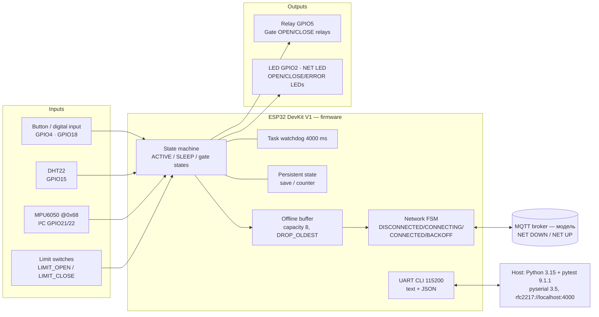

# Master Test Plan — Smart IoT Safety Controller (ESP32)

| Поле | Значення |
|---|---|
| Автор | Nataliia Honcharova |
| Тип документа | Master Test Plan (фінальна робота курсу Embedded QA, Webinar 8) |
| Джерела фактів | Домашні роботи W1–W7 (див. [EVIDENCE_INDEX.md](EVIDENCE_INDEX.md)) |
| Пов'язані документи | [FINAL_TEST_MATRIX.md](FINAL_TEST_MATRIX.md) · [BUG_REPORTS.md](BUG_REPORTS.md) · [RELEASE_DECISION.md](RELEASE_DECISION.md) · [CASE_STUDY.md](CASE_STUDY.md) |

Головний принцип документа: **Risk → Test → Evidence → Decision**. Усі результати, числа та статуси в цьому плані взяті з виконаних домашніх робіт; кожен має посилання на evidence.

---

## 1. Document Purpose

**Продукт.** Smart IoT Safety Controller — навчальний пристрій на ESP32, який збирає дані з сенсорів, керує локальним actuator (relay / LED), приймає команди по UART і передає телеметрію по мережі (MQTT-модель), з watchdog-відновленням і збереженням стану.

**Яке рішення підтримує цей план.** Чи можна випустити firmware (GO / GO WITH RISKS / NO-GO), спираючись на evidence про те, що пристрій передбачувано поводиться не лише у happy path, а й при шумі на входах, помилках протоколу, зависанні, втраті живлення, втраті мережі та тривалій роботі.

**Важливе уточнення щодо бази фактів.** Підсистеми продукту перевірялись на **окремих навчальних збірках firmware (BUGGY)** у симуляторі Wokwi — по одній на вебінар (W1–W7). Інтегрованої збірки, яка об'єднує всі підсистеми, не тестувалось. Тому в цьому плані кожен ризик прив'язаний до тієї лабораторної збірки, на якій він реально перевірявся.

| Вебінар | Підсистема / збірка | Що перевірялось |
|---|---|---|
| W1 | Smart Gate Controller (Wokwi) | state machine воріт, relays OPEN/CLOSE, limit switches, LED-індикація |
| W2 | Debounce (ESP32 DevKit v1, BUTTON/NOISE → GPIO18, LED → GPIO2) | RAW interrupts vs logical events vs actions, шум під час critical operation |
| W3 | UART CLI HOMEWORK DEVICE v2.0 | парсер команд, валідація меж, довжина рядка, негативні входи |
| W4 | WEBINAR 4: I2C PRACTICE / BUGGY (MPU6050 @ 0x68, SDA GPIO21 / SCL GPIO22) | I²C транзакції, ACK/NACK, поведінка firmware при втраті периферії |
| W5 | Recovery build BUGGY (DHT22 GPIO15, Button GPIO4, LED GPIO2, Relay GPIO5, WDT 4000 ms) | sensor fault, bounce, deep sleep, WDT, безпечний стан relay, interrupted save |
| W6 | DEMO / BUGGY firmware з JSON-протоколом по serial | Python/Pytest автоматизація: PWM, LED, RESET, GET TEMP, STATUS, timeout |
| W7 | IoT Network Node, `homework_buggy` (Wokwi у VS Code) | network state machine, reconnect/backoff, offline buffer, duplicates, heap |

---

## 2. System Overview

| Аспект | Опис (за фактичними збірками) |
|---|---|
| **Hardware** | ESP32 DevKit / DevKit V1; DHT22 (GPIO15); кнопка (GPIO4 у W5, GPIO18 у W2 разом з входом NOISE); MPU6050 на I²C 0x68 (GPIO21/22); relay (GPIO5); LED (GPIO2); у W1 — relays OPEN/CLOSE, кінцеві вимикачі та LED OPEN/CLOSE/ERROR |
| **Firmware** | task watchdog `timeout=4000 ms`; команди `help, status, sensor, relay on/off, save, sleep <s>, hang, powerloss, reboot` (W5); CLI `help, status, set speed <0..255>, set timeout <1..60>, led on/off, save, reset` (W3); JSON-команди `SET PWM N, SET LED, RESET, GET TEMP, STATUS, PING` (W6); мережеві команди `NET DOWN/UP, SEND, STRESS N, BUFFER, STATUS, RESET STATS` (W7) |
| **Interfaces** | UART 115200 (текстовий CLI і JSON-відповіді); I²C; serial-over-network RFC2217 для host-автоматизації; мережева модель MQTT publish |
| **External dependencies** | MQTT broker / мережа (у симуляції вмикається/вимикається командою), host-ПК з Python/pytest, симулятор Wokwi |
| **Critical data** | persistent `counter` / стан (W5); конфігурація `speed`, `timeout`, `LED` (W3); значення PWM (W6); telemetry message ID та лічильники `sent / dropped / duplicates` (W7) |
| **Critical actuators** | relay (GPIO5) — має бути OFF після аварійного reset (вимога R5, W5); gate OPEN/CLOSE relays — мають вимикатись на кінцевому вимикачі (вимога R6, W1); LED/PWM — `RESET` має повертати безпечний стан OFF/0 (вимога 7, W6) |

---

## 3. Quality Objectives

| # | Характеристика | Що вона означає для продукту | Вимоги, на яких перевірялась |
|---|---|---|---|
| QO-1 | **Safety of actuators** | після reset, RESET-команди, кінцевого вимикача чи fault actuator переходить у безпечний стан | W1 R6; W5 R5; W6 req. 7 |
| QO-2 | **Input robustness** | один фізичний press = одна дія; шум і некоректні команди не викликають дій і не змінюють стан | W2 AC 1–5; W3 REQ-03/05/06/08/11/12; W5 R3; W6 req. 5 |
| QO-3 | **Recoverability** | після hang / помилки периферії / втрати мережі пристрій повертається у робочий стан без втручання | W4 REQ-08; W5 T04, T07; W7 R1, R2, R5 |
| QO-4 | **Data integrity** | збережений стан — або старий валідний, або новий валідний; телеметрія не губиться мовчки і не дублюється | W5 R6; W7 R3, R4, R6 |
| QO-5 | **Long-run stability** | free heap не падає систематично при тривалій роботі | W7 R7 |
| QO-6 | **Observability** | стан і лічильники видно у STATUS/логах так, щоб QA міг довести висновок | W7 R8; W6 req. 3 (валідний JSON) |

---

## 4. Scope

У межах цього плану тестуються (і фактично тестувались):

1. **Firmware logic / state machines** — стани воріт (W1), ACTIVE/SLEEP/відновлення (W5), мережевий FSM (W7).
2. **Digital input handling** — debounce, шум, утримання, швидкі натискання (W2, W5 T02).
3. **UART CLI** — позитивні, граничні, негативні входи, довжина рядка, послідовність команд (W3); JSON-протокол (W6).
4. **I²C protocol behavior** — ACK/NACK, адресація, реакція firmware на втрату периферії (W4).
5. **Recovery / fault injection** — `hang` → WDT, 15 циклів hang/recovery, `powerloss` під час save, від'єднання DHT22, `sleep 5` (W5).
6. **Network state machine** — NET DOWN/UP, reconnect/backoff, offline buffer (5, 8, 9, 12 повідомлень), дублікати, STRESS (W7).
7. **Memory stability** — тренд free heap по 13 ітераціях `STRESS 100` (W7).
8. **Automation** — 20 pytest-тестів через RFC2217 (W6).

---

## 5. Out of Scope

| Що не тестується | Чому | Де це потрібно перевірити |
|---|---|---|
| Реальна механіка кнопки (contact bounce) | симульований bounce не відповідає реальному контакту (зазначено у Release Decision W5) | real hardware |
| Фізичне від'єднання DHT22 | у W5 перевірено лише в симуляції | real hardware |
| Реальний Wi-Fi / MQTT: падіння AP, DNS, слабкий сигнал, часткові втрати пакетів, QoS/ack | у симуляції мережа рветься лише бінарно (`NET DOWN`) | real network |
| Масовий reconnect багатьох нод після рестарту broker | одна нода в симуляції | real network / стенд |
| Збереження offline-буфера при reboot, reboot під час flush | перезавантаження пристрою у W7 не перевірялось | real hardware |
| Довгі прогони 8–72 год | найдовший прогін — 13 ітерацій `STRESS 100` | real hardware |
| Electrical: brown-out threshold, EMI/EMC, реальний знос flash, температурна кваліфікація | недоступні в симуляторі | лабораторія / real hardware |
| SPI | у курсових роботах SPI-трейс не знімався, перевірено лише I²C | наступна ітерація |
| BVA тривалості імпульсу кнопки (1, 5, 10, 20, 29, 30, 31, 50 ms) | у W2 TC-07 зафіксовано *testability limitation* — симулятор не дав згенерувати імпульс заданої тривалості | real hardware / генератор сигналів |

---

## 6. Assumptions / Constraints

- **Середовище — симуляція.** Усі тести виконано у Wokwi (у W5 і W7 — Wokwi для VS Code). Реальне залізо не використовувалось.
- **Fault injection — штучний.** Збої вводяться командами (`hang`, `powerloss`, `sleep N`, `NET DOWN/UP`, `STRESS N`), перемикачем FAULT (W4) або входом NOISE (W2).
- **Збірки навмисно дефектні (BUGGY).** Мета — знайти дефекти, а не підтвердити якість релізу.
- **Logic analysis.** У W2 використано логічний аналізатор симулятора (канали D0 RAW / D1 LOGICAL); у W4 — VCD-трейс `i2c-capture.vcd`, розібраний I²C-декодером у PulseView.
- **Black-box підхід.** У W3 дефекти шукались без попереднього читання коду firmware.
- **Час** вимірюється за мітками симулятора (`[TIMESTAMP_...]`, мітки serial monitor); вони можуть відрізнятися від годинника реального пристрою.
- **Мережа — модель.** Брокер не реальний; `NET DOWN` — ідеальний бінарний обрив.

---

## 7. Quality Risks

Шкала: **Impact** — наслідок для користувача/продукту; **Probability** — фактична відтворюваність у тестовій збірці; **Priority** = Impact × Probability (P1 — блокує реліз).

| Risk ID | Risk (failure mode → impact) | Impact | Probability (факт) | Priority | Mitigation / Test | Результат |
|---|---|---|---|---|---|---|
| R01 | Bounce або короткий шум на вході створює зайву logical event → **несанкціонована дія actuator**, у т.ч. під час critical operation | High | 5/5 (W2); 24 події на 20 натискань (W5, 100%) | **P1** | W2 TC-01…06, W5 T02 | FAIL |
| R02 | UART CLI приймає некоректні дані або падає → **невалідна конфігурація** (speed 256→255, timeout 0) чи **reboot** від 41-символьного рядка | High | 5/5 для кожного з 5 дефектів (W3); 100% (W6) | **P1** | W3 TC-01…22, W6 test_boundaries | FAIL |
| R03 | Втрата I²C-периферії → **MCU зависає**, main loop не виконується, немає retry/recovery | Critical | 5/5 (W4) | **P1** | W4 FAULT ON/OFF + trace | FAIL |
| R04 | Після hang/WDT або команди `RESET` **actuator лишається увімкненим** (relay=ON, LED=ON, PWM≠0) | Critical (safety) | 100% (W5 T05; W6 test_reset) | **P1** | W5 T04, T05, T07; W6 test_reset | FAIL (WDT-відновлення працює; safe state — ні) |
| R05 | Переривання запису (`powerloss`) → **змішаний/невалідний persistent state** | Critical | 100% (W5 T06) | **P1** | W5 T06 | FAIL |
| R06 | Втрата мережі → нода не відновлюється або створює **reconnect storm** | High | storm 6/6 (W7 BUG-02); відновлення — 100% прогонів | **P2** | W7 Scenario A, network state model | R1/R5 PASS, R2 FAIL |
| R07 | Offline-буфер при переповненні **мовчки губить** повідомлення і/або **дублює** publish | High | duplicates 3/3; boundary 2/2 (W7) | **P1** | W7 Scenario B, C (8/9/12 SEND), E | R3 PASS, R4 FAIL, R6 FAIL |
| R08 | Тривала робота → **систематичне падіння free heap** → відмова ноди з часом | Critical | 13/13 ітерацій (W7 BUG-03) | **P1** | W7 Scenario D (STRESS 100 × 13) | FAIL |
| R09 | Кінцевий вимикач не зупиняє рух → **motor relay лишається ON** у стані OPENING | Critical (safety) | 5/5 (W1 BR-01) | **P1** | W1 TC-02, TC-04 | FAIL |
| R10 | Несправний сенсор → **невалідні дані** або **невалідна відповідь** протоколу | Medium | W6: 100% (битий JSON у `GET TEMP`) | **P2** | W5 T01, W6 test_sensor | W5 T01 PASS; W6 FAIL |
| R11 | Невірна тривалість deep sleep → **порушення графіку роботи / енергобюджету** | Medium | 100% (W5 T03: 1.368 s замість 4.25–5.75 s) | **P2** | W5 T03 | FAIL |
| R12 | Індикація не відповідає стану (OPEN LED світиться у STOPPED) → **оператор хибно читає стан** | Low | 5/5 (W1 BR-02…04) | **P3** | W1 TC-05, TC-06, TC-10 | FAIL |

Детальна трасованість ризик → тест → evidence: [FINAL_TEST_MATRIX.md](FINAL_TEST_MATRIX.md).

---

## 8. Test Levels

| Level | Що перевіряє | Де застосовано (факт) | Ризики |
|---|---|---|---|
| Component / firmware function | окремі функції: валідація параметрів, переходи state machine | W1 (переходи воріт), W3 (валідація speed/timeout), W6 (PWM boundaries) | R02, R09, R12 |
| Interface / protocol | формат і коректність обміну | W3 UART CLI; W4 I²C ACK/NACK по трейсу; W6 JSON-відповіді | R02, R03, R10 |
| System | поведінка пристрою «вхід → логіка → actuator» | W2 RAW → LOGICAL → ACTION; W5 T02; W1 сценарії руху воріт | R01, R09 |
| Recovery / fault injection | реакція на збій і повернення в робочий стан | W4 FAULT switch; W5 `hang`, `powerloss`, DHT disconnect, `sleep`; 15 циклів hang/recovery | R03, R04, R05, R10, R11 |
| Network | reconnect, buffer, duplicates | W7 сценарії A, B, C, E | R06, R07 |
| Reliability / memory | тренд ресурсів під навантаженням | W7 сценарій D (13 × STRESS 100) | R08 |
| Regression | повторний запуск після змін | W6 pytest-набір (20 тестів) — автоматизований; решта — ручні кандидати (розд. 13) | R02, R04, R10 |

---

## 9. Test Types

| Test type | Приклади з виконаних робіт |
|---|---|
| Functional | W1 TC-01, TC-07, TC-08; W3 `help`, `led on/off`; W6 `test_led_on_off`, `test_status` |
| Boundary / negative | W3: speed −1/0/1/254/255/256/257, timeout 0/1/2/59/60/61, довжина 40/41, спецсимволи, `STATUS` у верхньому регістрі; W6: PWM −1/0/1/50/99/100/101/999, `aa`, `1.5`, спецсимволи, порожнє значення |
| Protocol | W4 аналіз I²C-трейсу (Start, Address, R/W, ACK/NACK, Repeated Start, Stop) |
| Reliability | W2 5 швидких натискань, long press 2–5 s; W5 20 натискань |
| Recovery | W5 `hang` → INT_WDT, 15 циклів hang/recovery; W4 FAULT ON → OFF |
| Persistence | W5 `powerloss` під час save (before/after STATUS) |
| Network stress | W7 NET DOWN ~20 s, SEND ×5/8/9/12 під час обриву |
| Memory stability | W7 `STRESS 100` × 13 з фіксацією heap |
| Automation | W6 pytest + pyserial через `rfc2217://localhost:4000` |

---

## 10. Test Environment

| Environment | Purpose | Tools (факт) | Що **може** довести | Що **не може** довести |
|---|---|---|---|---|
| Wokwi | firmware / system simulation, fault injection | Wokwi (web; у W5, W7 — Wokwi для VS Code), ESP32 DevKit V1, serial 115200 | логіку станів, обробку команд, реакцію на штучні збої, відтворюваність | реальну електрику, механічний bounce, реальні таймінги RF/мережі, знос flash |
| Logic analysis | protocol evidence | логічний аналізатор Wokwi (D0 RAW / D1 LOGICAL, W2); VCD `i2c-capture.vcd` + I²C decoder у PulseView (W4) | коректність фреймів, ACK/NACK, момент першої помилки, співвідношення RAW/LOGICAL | якість сигналу на реальній шині (фронти, ємність, підтяжки) |
| Host automation | regression | Python 3.15, pytest 9.1.1, pyserial 3.5, `DEVICE_PORT=rfc2217://localhost:4000` | повторюваний контроль контракту команд і відповідей | фізичний стан виходів (перевіряється лише те, що firmware повідомляє) |
| Network model | network behavior | команди `NET DOWN/UP`, `SEND`, `STRESS N`, `STATUS`, `RESET STATS` (W7) | state machine, backoff, буфер, дублікати, heap-тренд | реальні Wi-Fi/MQTT збої, QoS, масовий reconnect |
| Real hardware | electrical / physical validation | **не використовувався** | — | — (див. Residual Risks) |

---

## 11. Entry Criteria

Тестування циклу починається, коли:

1. Відома збірка firmware (назва/режим: NORMAL / BUGGY, банер при старті, для W5 — `ELF file SHA256: f9dc9c5a6b4fba7e`).
2. Є перелік вимог з ID, на які посилаються тести й bug reports (як у робочих збірках: `R6`, `R14` у W1; `REQ-03…REQ-12` у W3/W4; `R3…R6` у W5; пункти 3, 5, 7 у W6; `R1…R8` у W7).
3. Стенд готовий: Wokwi-проєкт запускається, serial 115200 відкривається, пристрій виводить банер / `READY` / список команд.
4. Зафіксовано baseline: `STATUS` після старту або `RESET STATS` (як у W7: `net=CONNECTED, buffer=0/8, sent=0, dropped=0, duplicates=0, heap=350868`).
5. Логування достатнє: таймстемпи у serial-лозі, `reset_reason` при старті, лічильники в STATUS.
6. Для автоматизації — доступний `DEVICE_PORT`, порт не зайнятий іншим процесом, залежності встановлено.
7. Критичні інтерфейси доступні (I²C пристрій відповідає ACK у FAULT OFF; мережа в стані CONNECTED перед мережевими сценаріями).

---

## 12. Exit Criteria

| Criterion | Target |
|---|---|
| Critical tests (P1-ризики R01–R05, R07–R09) виконано | 100% |
| Critical tests пройдено | 100% PASS |
| Відкриті дефекти Critical | 0 |
| Відкриті дефекти High/Major без погодженого residual risk | 0 |
| Recovery-сценарії (WDT, powerloss, I²C fault, NET DOWN/UP) | PASS, actuator у безпечному стані після кожного |
| Regression (pytest-набір W6) | 20/20 PASS |
| Memory stability | немає систематичного падіння heap за ≥ 10 ітерацій `STRESS 100` |
| Evidence | для кожного FAIL і кожного P1 PASS є лог/трейс/скріншот у Evidence Package |

Фактичний статус за цими критеріями — у [RELEASE_DECISION.md](RELEASE_DECISION.md).

---

## 13. Regression Strategy

**Що вже автоматизовано (W6, код — [`automation/`](automation/)):** 21 pytest-кейс (у журналі виконання W6 записано 20) — `test_boundaries.py` (PWM: valid 0/1/50/100, saved 1/99, invalid −1/101/999, malformed `aa`/`1.5`/спецсимволи, empty), `test_relay.py`, `test_reset.py`, `test_sensor.py`, `test_status.py`, `test_timeout.py`. Запуск — після кожної зміни firmware.

**Що запускається після значущої зміни (за зоною зміни):**

| Зміна в firmware | Обов'язковий regression | Ризики |
|---|---|---|
| CLI / парсер / валідація | W3 TC-01…22 (особливо TC-08, 11, 17, 20, 22), W6 `test_boundaries.py` | R02 |
| Обробка входів / debounce | W2 TC-01…06, W5 T02 (20 натискань = 20 подій) | R01 |
| Actuator / reset / watchdog | W5 T04, T05, T07; W6 `test_reset.py`; W1 TC-02, TC-04 | R04, R09 |
| Persistence | W5 T06 (`powerloss` двічі поспіль) | R05 |
| I²C драйвер | W4 FAULT OFF → ON → OFF з трейсом | R03 |
| Network stack | W7 сценарії A (reconnect/backoff), B (5 SEND), C (8/9/12 SEND), E (duplicates), D (STRESS × ≥10) | R06, R07, R08 |
| Sleep / power | W5 T03 | R11 |

Кандидати на автоматизацію наступними (зараз виконуються вручну): W3 CLI-кейси (той самий підхід, що у W6), W5 T05 (relay після WDT), W7 сценарії C і E (підрахунок `[MQTT] publish id=` у лозі) та D (heap-тренд).

---

## 14. Evidence Strategy

| Тип finding | Потрібний evidence | Приклад з робіт |
|---|---|---|
| State transition (FSM) | timestamped serial log з переходами `STATE: A -> B` | W1 логи Smart Gate; W7 `[NET] state=...` |
| Debounce / input | лічильники RAW / LOGICAL / ACTIONS + канали D0/D1 логічного аналізатора; відео для серії натискань | W2 LoggerEvidence; W5 `ButtonBounce2026-10-29.mov` |
| Protocol (I²C) | трейс з декодером + firmware log у той самий момент | W4 `i2c_last_ack.png`, `i2c_first_nack.png`, `[E][Wire.cpp:499] ... Error -1` |
| Recovery / WDT | `reset_reason` після старту + STATUS JSON до/після; час hang → boot | W5 `hang.txt`, `boot_loop.txt`, `INT_WDT` + `"relay":true` |
| Persistence | STATUS до/після `powerloss` | W5 `counter 0 → 100`, `101 → 201` |
| Automation | pytest output (FAILED + assert) + raw serial response | W6 скріншоти pytest, `Device response: {...}` |
| Network / buffer | лог з message ID (`queued id=`, `publish id=`) + STATUS лічильники | W7 `BUFFER.log`, `SEND_BUFFER_8/9/12.log` |
| Memory | таблиця heap по ітераціях (Δheap, байт/повідомлення), а не одне значення | W7 `STRESS.log`, аркуш `D_Memory` |

Правило: evidence має дозволяти іншій людині самостійно перевірити висновок QA. Скріншот без логу чи контексту — слабкий evidence.

---

## 15. Defect Management

- **Severity** (уніфікована шкала, за визначеннями з W7):
  - **Critical** — безпека, втрата/псування даних, повна відмова, або нода перестає працювати з часом;
  - **Major (High)** — порушено важливу вимогу, обхідного шляху немає;
  - **Medium** — часткова відмова або є обхідний шлях;
  - **Minor (Low)** — косметика, неточний лог без впливу на дані.
- **Reproducibility** фіксується як `N/M` (наприклад 5/5, 13/13) або 100%.
- **Кожен bug report містить:** вимогу, precondition, кроки, expected/actual, environment/build, raw evidence (лог/трейс/скріншот), severity, reproducibility.
- **Класифікація FAIL** (з W6): Test (oracle/assert), Environment (порт, залежності), Communication (timeout/транспорт), Requirement (чи expected справді вимагається), Firmware (стабільна невідповідність вимозі). Приклад: W6 T-18 `test_ping` — `TimeoutError` класифіковано як **Test**, а не Firmware.
- **Retest:** після fix — повтор кроку з bug report + відповідний regression з розд. 13.
- Зведений журнал 24 дефектів: [BUG_REPORTS.md](BUG_REPORTS.md).

---

## 16. Residual Risks

| # | Що лишається неперевіреним / ризиковим | Чому |
|---|---|---|
| RR-1 | Поведінка на реальному залізі (механічний bounce, фізичне від'єднання DHT22, реальні таймінги sleep) | лише симуляція |
| RR-2 | Реальний Wi-Fi/MQTT: різні види збоїв, QoS/ack-дублікати, масовий reconnect | мережа моделювалась бінарно |
| RR-3 | Час до відмови через витік heap | 13 ітерацій показують тренд (≈80 Б на повідомлення), але нижня межа працездатності невідома; потрібні прогони 8–72 год |
| RR-4 | Втрата offline-буфера при reboot; reboot під час flush | не перевірялось |
| RR-5 | Причина пауз retry у кілька секунд під час вводу команд (W7) | не встановлена; можливий артефакт симулятора |
| RR-6 | SPI-периферія | не тестувалась |
| RR-7 | BVA тривалості імпульсу кнопки | testability limitation симулятора (W2 TC-07) |
| RR-8 | Requirements W4 REQ-09…REQ-12 (retry / recovery I²C) | BLOCKED через зависання MCU |
| RR-9 | Інтеграція підсистем в одній збірці | підсистеми тестувались на окремих збірках |

---

## 17. Release Recommendation

**NO-GO.**

Рішення ґрунтується не на відсотку PASS, а на характері відкритих дефектів:

- **Safety:** actuator лишається ввімкненим після аварійного WDT reset (W5, relay=ON після `INT_WDT`), після команди `RESET` (W6, `led=true`, `pwm=12`) і при спрацюванні кінцевого вимикача (W1, OPEN relay=ON у стані OPENING).
- **Data integrity:** `powerloss` дає невалідний стан (`counter` 0 → 100); буфер мовчки втрачає найстаріші повідомлення (`dropped=0`) і дублює publish (`sent=10` на 5 повідомлень).
- **Availability:** зависання MCU при втраті I²C-периферії без відновлення (W4); систематичний витік heap 350868 → 246600 Б за 13 ітерацій (−29,7%) (W7).
- **Input robustness:** шум запускає дію під час critical operation (W2); 41-символьний рядок перезавантажує пристрій (W3).

Відкрито **6 Critical** дефектів — Exit Criteria «0 open Critical» не виконано. Деталі та статус кожного критерію: [RELEASE_DECISION.md](RELEASE_DECISION.md).
